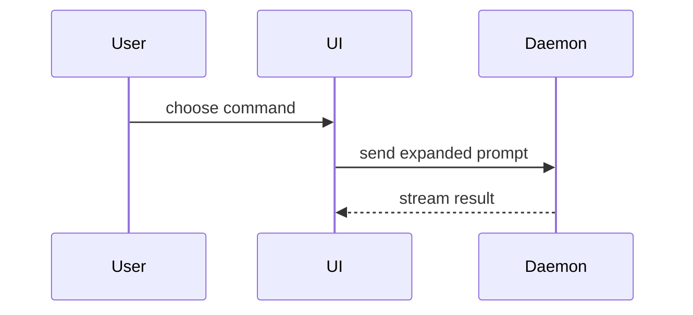

A PR body is read by reviewers who check each claim against the diff, and later
by whoever finds the squash commit. The body is done when every statement in the
title and body is true of the head you post, each result says how it is known,
and every change in the diff is accounted for.

The repository's rules come first: its `AGENTS.md`, and its pull request
template if it has one: a `pull_request_template` file (`.md` or `.txt`, any
case) in the root, `docs/` or `.github/`, or a file in a `PULL_REQUEST_TEMPLATE/`
folder there; failing those, the same in the owner's public `.github`
repository. Start the body file from that template, since
`gh pr create --body-file` does not fill it in. Put the sections and reports the
repository asks for beside the ones below.

Use this template for writing the PR body:

```markdown
<Closes #<n>, one line per issue the PR finishes, or Part of #<n>>

## Summary

<diagram, diff-sketch, or tree>

## Evidence

- **Before:** <screenshot/output/failing test run>
  **After:** <screenshot/output/passing test run>

<optional: ## Review, when the change went through adversarial review>

<optional: ## Decisions, for calls a reviewer should check>

## Merge Danger

**Door:** <one-way or two-way>

<optional: description>

**Blast Radius:** <one-word description>

<optional: potential ramifications of merge, and what must happen around it>
```

## Sections

Skip all preambles and keep prose brief. Use the user's domain language from `GLOSSARY.md`.

### Title and closing line

A squash merge makes the title the commit's subject, except that by GitHub's
default a PR with one commit lands under that commit's own subject. So the title,
and a lone commit's subject, follow the repository's commit-subject format and
say what the branch does at its head.

The body opens with `Closes #<n>` for each issue the PR finishes. For part of
one, write `Part of #<n>`, and keep `close`, `fix` and `resolve`, in any form,
away from `#<n>` everywhere in the body: GitHub can close the issue on any of
them, in any sentence. Mention an issue you are not closing as "tracked in
#<n>". [Posting](#posting) checks this.

### Summary

Pick the smallest view that makes the key point clear.

- Show logic or an algorithm as pseudocode:

```text
on(save)
  if content is unchanged
    return cached result
  write new content
  return fresh result
```

- Show runtime control flow as a call tree:

```text
submitForm
  createSession
    persistPrompt
    launchAgent
  navigateToSession
```

- Show UI structure as a component tree, including state and module boundaries that matter:

```text
<SessionPage> (apps/example/src/routes/session.tsx)
  useSessionEvents()
  <SessionToolbar>
    <RunSkillButton> (packages/ui)
```

- Show file responsibility or a broad refactor as a shallow file tree:

```text
src/
├── commands/       # parses user actions
├── sessions/       # owns session state
└── transport/      # sends API requests
```

- Show component interaction, control flow, or data flow with Mermaid:



- Use `diff` when the point is what changes and the surrounding shape already exists. Match the diff shape to the topic.

For a component change:

```diff
 <SessionPage>
   useSessionEvents()
   <SessionToolbar>
+    <RunSkillButton />
   <SessionTimeline>
+    <SkillResultCard />
```

For a file-layout change:

```diff
 src/
 ├── commands/
+│   └── show-me.ts       # expands the slash command
 ├── sessions/
-└── transport.ts
+└── transport/
+    ├── client.ts
+    └── stream.ts
```

For a call-tree or call-stack change:

```diff
 submitForm
   createSession
     persistPrompt
+    expandSkillMention
     launchAgent
-  navigateToSession
+  navigateToSession
+    subscribeToEvents
```

For a state or control-flow change:

```diff
 on(save)
-  write content
+  if content is unchanged
+    return cached result
+  write new content
+  invalidate cache
```

- Show the whole block when most of it is new, when omitted context would hide ownership or order, or when the user needs a copyable target shape:

```ts
function expandSkill(command: string): string {
  const skillName = command.slice(1);
  return `use the ${skillName} skill`;
}
```

#### Guidance

Place each visual next to the short text it supports. Keep only the calls, files, props, states, and boundaries needed to answer the user's current question or the options to resolve the current discussion point.

You may use one of these, you may use several, it is unlikely you will use all of them. Use your judgement and don't overwhelm the user.

#### The whole diff

After the visual, list what else the diff carries, incidental edits included,
and what you found but filed rather than fixed ("Out of scope, tracked in
#<n>"). A reviewer who finds a change the body never mentions stops trusting the
rest of it.

### Evidence

Concrete evidence that the change works. Show a before and after.

Screenshots are S-tier - when the environment is set up for it and the change is visual.

Execution-based evidence is A-tier. Test results, console output. Show the exact test that now fails and passes, using pseudocode.

Screenshots show test data, never a real account's.

Reviewers re-run what the body claims, so each claim you make holds on the head
you post:

- **Say how you know.** Each result is **ran** (the command and what it gave),
  **read** (`file:line`, or the library's source at its version) or
  **reasoned** (from the code, not observed). A prediction written as a result,
  such as "fails on `main`" when nobody ran it there, is the first claim a
  reviewer disproves.
- **Measure after the last edit.** A review round that adds a test makes every
  count before it stale: tests passed, mutants killed, files changed. Name the
  commit each count ran on.
- **Claims about code the PR doesn't change** need proof too: "unused", "the
  only caller", "nothing else reads it". Show the search, and that it covered
  everything.
- **An absolute** (*cannot*, *never*, *every*, *only*) holds over every case,
  not just the cases you built. Check it, or write the smaller sentence.
- **Credit each check** to whoever ran it: you, a reviewer before the commit, or
  a person. A path someone only read is not a path they checked.
- **Acceptance:** when the issue lists acceptance items, give each with how it
  was checked, and leave unticked what nobody checked.
- **New tests:** name each one, and what you broke to watch it fail
  ([red again](../writing-tests/SKILL.md#the-loop)).
- **Gates:** the repository's gates, each with its result and exact counts.

### Review

When the change went through adversarial review, report it here. A PR opened on
a verdict other than `SHIP` starts the section by saying so. Then give:

- the rounds, and each one's verdict;
- each finding and what became of it: fixed, filed as `#<n>`, or not addressed,
  and why;
- what the reviewer verified for itself, so the next reviewer knows which
  properties are load-bearing;
- any text changed after the last round, which no reviewer has read.

### Decisions

The calls you made that a reviewer should check, such as a question the issue
left open. Give each with the alternatives you weighed and why this one won.
Leave out choices nobody would make differently.

### Merge Danger

Describe whether it's a one-way or two-way door. You can walk back through two-way doors, but not one-way doors. A PR that is cheap to roll back is lower risk. Changes that involve destructive actions or hard-to-reverse decisions are one-way doors.

The blast radius is the potential impact or scope of the changes introduced by this PR. Consider all possibilities. Examples are layout shift, breakages for consumers, mobile responsiveness, etc.

When anything must happen around the merge, list it in order: a migration to
run, config or secrets to set first, the PRs in other repositories that this one
depends on with their merge order, and the rollback order when schema and code
roll back separately.

## Posting

- **Write the body to a file** with a quoted heredoc (`<<'EOF'`), and pass
  `--body-file <file>` to `gh pr create` or `gh pr edit`, or `-F body=@<file>`
  to `gh api`. A body written inline runs its own backticks as command
  substitution, exits 0 and prints a URL.
- **Update the body with every push**, in the same step and before anyone asks.
  Re-read it against the new head: the counts and the commit they ran on, the
  Summary's sketch, the review rounds, and every claim about a commit a rebase
  dropped.
- **Check the closing keywords** after every push or edit. A keyword reaches
  `main` three ways: the branch's commit messages, the title, and the body.
  Run both of these:

  ```bash
  { gh pr view <n> --json title --jq .title
    gh api --paginate "repos/{owner}/{repo}/pulls/<n>/commits" --jq '.[].commit.message'; } \
    | grep -inwE '(close[sd]?|fix(es|ed)?|resolve[sd]?):?[[:space:]]+(([-[:alnum:]._]+/[-[:alnum:]._]+)?#|GH-|https://github\.com/[-[:alnum:]._]+/[-[:alnum:]._]+/issues/)[0-9]+'
  gh pr view <n> --json closingIssuesReferences --jq '[.closingIssuesReferences[].number]'
  ```

  The first prints each line of the title and of the PR's commits, as GitHub
  lists them, that puts a keyword before a reference. The second lists the
  issues linked to the PR, by the body's keywords or by hand: compare it with
  the issues the PR should close. On a PR to a branch other than the default,
  GitHub may not link the body's keywords yet, so an issue missing there is no
  proof the body is wrong; check again once the PR targets the default branch.
- **After the merge**, the body and the squash message are history. Correct a
  claim that turns out wrong in a comment on the PR.
